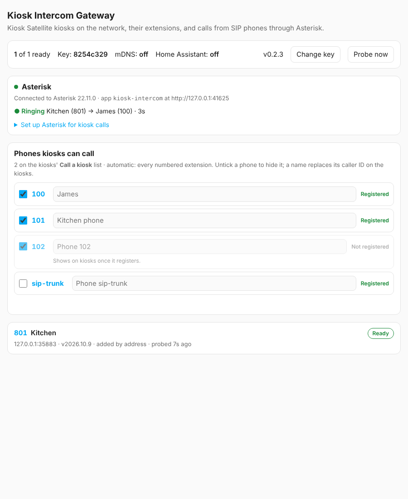
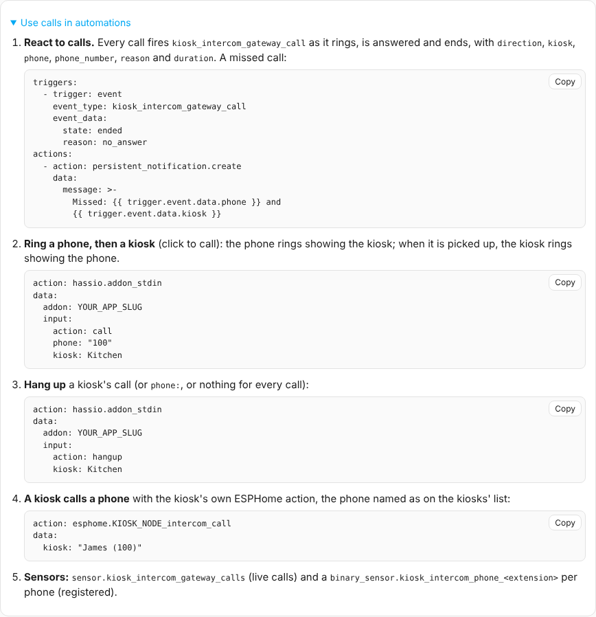

<p align="center"></p>

# Kiosk Intercom Gateway

A Home Assistant app that connects [Kiosk Satellite](https://github.com/jxlarrea/kiosk-satellite)'s
intercom to the SIP phones on [Asterisk](https://github.com/TECH7Fox/asterisk-hass-addons), both ways:

- **Phones call kiosks.** Every kiosk gets an extension (801, 802, …). Dial it and the kiosk rings
  like an intercom call, showing who's calling.
- **Kiosks call phones.** Registered phones appear in every kiosk's **Call a kiosk** list.
- **Announce to all.** Dial 800 from a phone and every Ready kiosk hears you.
- **Automations.** Calls fire Home Assistant events, can be started and ended from automations,
  and show as sensors.

Audio is two-way 16 kHz. Nothing changes on the kiosks: the gateway speaks their intercom protocol.

<p align="center"></p>

## Quick start

1. Add this repository to Home Assistant: **Settings → Apps → store → ⋮ → Repositories** →
   `https://github.com/jfarcher/kiosk-intercom-gateway`, then install **Kiosk Intercom Gateway**.
2. Start it, open **Kiosk Intercom** in the sidebar, and paste the kiosks' **Intercom key**
   (any kiosk: Settings → Intercom). Your kiosks show **Ready** with their extensions.
3. For calls, install the **Asterisk** app and start it once. On the status page, press **Set up
   Asterisk for me**, then restart the Asterisk app. (The card also shows the files, to do it by hand.)
4. Pick which phones the kiosks can call on the **Phones** card.

Full documentation is in [DOCS.md](kiosk_intercom_gateway/DOCS.md), also shown on the app's
Documentation tab.

## What it does

- **Finds kiosks automatically** over mDNS (`_kiosk-satellite._tcp`), the same way kiosks find
  each other. Kiosks mDNS cannot reach (another VLAN) can be added by address. Each kiosk is
  probed at `/api/intercom/identity` and shows the same status words as the kiosks' own list:

  | Status | Meaning |
  | --- | --- |
  | Ready | The intercom is on with the same key as the gateway. |
  | Do not disturb | The kiosk refuses calls right now. |
  | Different key | The kiosk holds another key. |
  | Intercom off | The kiosk is reachable but its intercom is off. |
  | Unreachable / Offline | The kiosk does not answer, or no longer announces itself. |

- **Gives every kiosk an extension** (801, 802, …) that it keeps. A call to it over Asterisk's
  ARI rings the kiosk with the caller's name. The kiosk's own Ring / Auto / DND rules apply,
  and on answer the gateway bridges the audio. Declines, busy kiosks and timeouts reach the
  caller as the matching SIP cause.
- **Offers Asterisk's phones to the kiosks.** Each phone is announced over mDNS the way kiosks
  announce themselves, with its own port and intercom identity, so it appears in every kiosk's
  **Call a kiosk** list. The gateway rings it with ARI `originate`. A phone stays listed while
  it is registered, and the status page picks which phones are offered.
- **Works with automations:** a `kiosk_intercom_gateway_call` event on every ring, answer and hang-up;
  `call` (phone first, then kiosk) and `hangup` actions through `hassio.addon_stdin`; a calls sensor
  and a registration sensor per phone.
- **Matches kiosks to Home Assistant** through their ESPHome devices, which adds each kiosk's
  area and HA's `Intercom` call state (best effort, by name).
- **Shows it all** on an ingress page (sidebar: *Kiosk Intercom*): kiosks, extensions, the
  Asterisk connection, live and recent calls, and setup steps. It also publishes
  `sensor.kiosk_intercom_gateway_kiosks`.

## Automations

<p align="center"></p>

The status page's **Use calls in automations** card has the YAML for the call events, the `call`
and `hangup` actions and the sensors, filled in with your own app slug, kiosks and phones.

## Requirements

Every kiosk needs **Remote management** and **Find other kiosks** turned on, as for the
intercom itself. For calls, set up the [Asterisk app](https://github.com/TECH7Fox/asterisk-hass-addons)
as the app's [documentation](kiosk_intercom_gateway/DOCS.md#2-connect-to-asterisk) describes:
one `ari.conf` and three dialplan lines.

Runs on amd64 and aarch64 Home Assistant OS installs. Tested with Kiosk Satellite 2026.10–11 and the
Asterisk app 6.3 (Asterisk 22.11); CI places real calls through that Asterisk image on every change.
The intercom wire is internal to Kiosk Satellite, so a future Kiosk Satellite release could need an
update here.

## How the intercom works

The protocol was worked out from reading the Kiosk Satellite source. No code from it is used.

- **Discovery:** mDNS `ks-<id>._kiosk-satellite._tcp.local`, TXT `id`, `name`, `version`,
  `port` (remote admin), `tls`.
- **Identity:** `GET /api/intercom/identity` on the admin port returns
  `{id, name, version, enabled, key, dnd, endpoint: {port, tls}}`. `key` is SHA-256(key)[:8].
  It is limited to one probe per second per client.
- **Signaling:** the caller sends `POST /api/intercom/call` with
  `{call, kind: call|broadcast, from: {id, name, port, version}}`. The callee replies
  `ringing` / `auto` / `busy` / `dnd` / `off`, or 403 for a wrong key. Later steps go back and
  forth as `POST /api/intercom/call/<id>` with `{action: answer|decline|missed|cancel|hangup}`.
- **Audio:** the caller opens `ws(s)://callee/api/intercom/audio/<id>?token=…`. Binary frames
  are PCM16 LE mono 16 kHz, 80 ms each. Text frames are `{"type":"talk","on":bool}` and
  `{"type":"end"}`.
- **Auth:** each request carries a single-use HMAC-SHA256 token keyed with `"intercom:" + key`.
  It is valid for 60 s (see [`protocol.py`](kiosk_intercom_gateway/src/kig/protocol.py)).

The wire format is internal to Kiosk Satellite and may change between releases.

## How a SIP call reaches a kiosk

```
phone ──SIP──▶ Asterisk ──Stasis(kiosk-intercom,801)──▶ gateway (ARI events)
                  │                                       │ POST /api/intercom/call  ──▶ kiosk rings
                  │                                       │ ◀── POST …/call/<id> answer
                  │◀──ARI: answer, externalMedia, bridge──┤
                  │◀═══ AudioSocket slin16 (TCP) ════════▶│◀═══ WebSocket PCM16 ═══▶ kiosk
```

The gateway acts as a kiosk toward the kiosk and as a Stasis app toward Asterisk. Call audio
uses **AudioSocket**, not RTP. Asterisk 22's ARI external media over RTP sends slin16 (payload
type 118) but drops it on receive: dynamic payload types need a receive mapping chan_rtp
never sets up. AudioSocket carries slin16 both ways (kind `0x12`, Asterisk 20.13 / 21.8 /
22.3 and later) in the kiosks' own byte order.

A kiosk calling a phone runs the same wire with the roles swapped. The kiosk POSTs the call to
the phone's own port, the gateway originates `PJSIP/<ext>` with `appArgs kig-out,<call id>`, and
on answer the gateway bridges AudioSocket and signals `answer`. The kiosk then opens its audio
WebSocket to the phone's port. The gateway re-sends each phone's PTR, SRV, TXT and A records in
one packet every 30 s, because kiosks drop a peer after three missed announcements.

CI places real calls through the Asterisk app's own image
(`ghcr.io/tech7fox/asterisk-hass-addon`), both into a simulated kiosk and from it to two PJSIP
test phones that Asterisk answers itself. It checks the audio in both directions and the
clean-up afterwards.

## Roadmap

1. Discovery and roster. Done in 0.1.
2. SIP → kiosk calls. Done in 0.2.
3. Kiosk → SIP calls. Done in 0.3.
4. Home Assistant events, actions and sensors. Done in 0.4.
5. Announce to all from a phone. Done in 0.5.
6. Kiosks with **Encrypt communications** on. Done in 0.6.
7. Prebuilt images, one-click Asterisk setup, problem notifications. Done in 0.7.

## Related work

[Eibelucas/Kiosk-Satellite-SIP](https://github.com/Eibelucas/Kiosk-Satellite-SIP) is a SIP
phone plugin plus a HAOS add-on that bundles Asterisk and bridges one configured kiosk to it.
This project differs in its focus: many auto-discovered kiosks, each with its own extension,
wideband audio, and the Asterisk app you may already run.

## Development

```sh
pip install -r requirements-dev.txt
pytest                      # unit and end-to-end tests against a fake Asterisk and fake kiosks
ruff check .
cd kiosk_intercom_gateway/src && KIG_KEY=<key> KIG_OPTIONS=/dev/null python3 -m kig  # page on :8099
```

Releases: bump `version` in `kiosk_intercom_gateway/config.yaml` (and `src/kig/__init__.py`) and
merge to main. The **Publish images** workflow builds and pushes
`ghcr.io/jfarcher/{amd64,aarch64}-kiosk-intercom-gateway:<version>`, which the Supervisor pulls. A
version is published once and never rebuilt.

## Licence

MIT. Kiosk Satellite is © Xavier Larrea under its own licence. This project talks to it over
the network and contains none of its code.
